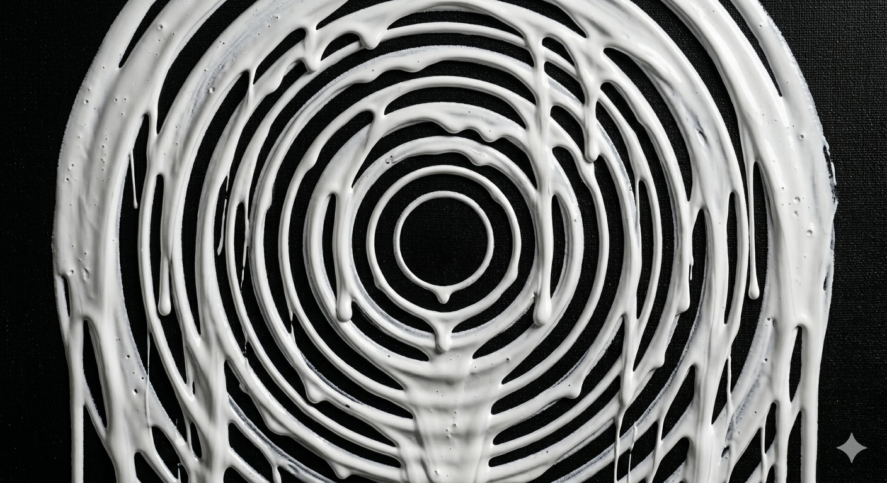
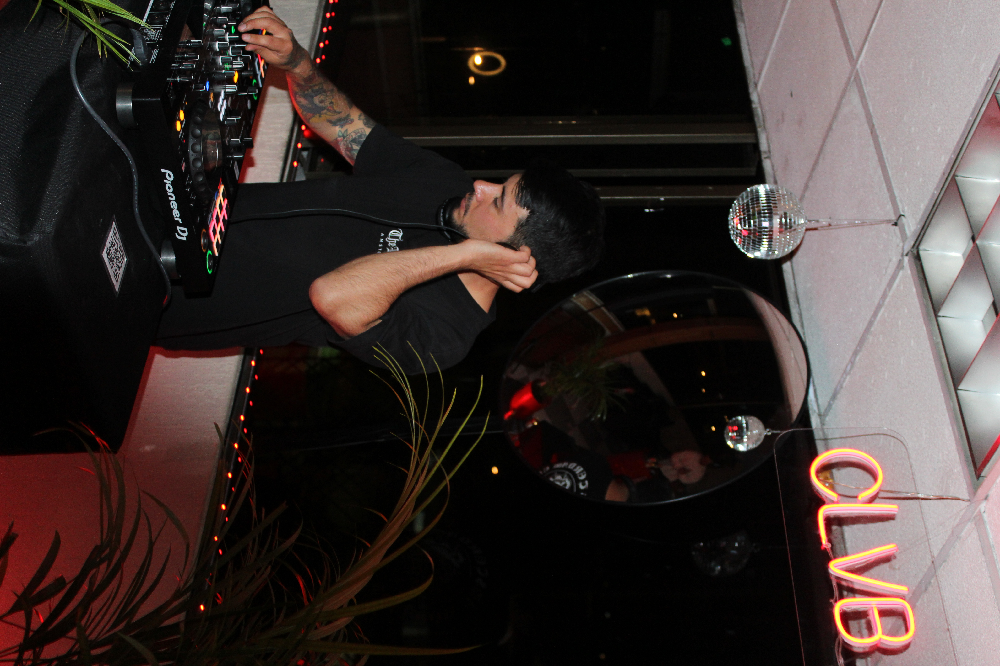

<!DOCTYPE html>
<html lang="es">
<head>
  <meta charset="UTF-8" />
  <meta name="viewport" content="width=device-width, initial-scale=1.0" />
  <meta name="description" content="IRAV — Hard Techno DJ & Producer | Electronic Press Kit" />
  <meta name="theme-color" content="#000000" />
  <title>IRAV | Press Kit</title>

  <!-- ══════════════════════════════════════════════════════════
       FAVICON — usa tu logo como favicon.
       Asegúrate de que la ruta sea correcta en tu servidor.
       ══════════════════════════════════════════════════════════ -->
  <link rel="icon" type="image/png" href="img/logo Blanco sin fondo.png" />

  <!-- Google Fonts — Tipografías brutalistas/techno -->
  <link rel="preconnect" href="https://fonts.googleapis.com" />
  <link rel="preconnect" href="https://fonts.gstatic.com" crossorigin />
  <link href="https://fonts.googleapis.com/css2?family=Bebas+Neue&family=Space+Grotesk:wght@400;500;600;700&display=swap" rel="stylesheet" />

  <!-- Estilos -->
  <link rel="stylesheet" href="css/styles.css" />
</head>

<body class="noise-overlay">

  <!-- ╔══════════════════════════════════════════════════════════╗
       ║  NAVBAR                                                  ║
       ╚══════════════════════════════════════════════════════════╝ -->
  <nav class="navbar" id="navbar">
    

      

      <ul class="navbar-links">
        <li><a href="#bio">Bio</a></li>
        <li><a href="#music">Music</a></li>
        <li><a href="#gallery">Gallery</a></li>
        <li><a href="#downloads">Downloads</a></li>
        <li><a href="#contact">Contact</a></li>
      </ul>

      <button class="hamburger" id="hamburger" aria-label="Abrir menú">
        
      </button>
    

  </nav>

  <!-- Mobile menu -->
  

    <a href="#bio" onclick="closeMenu()">Bio</a>
    <a href="#music" onclick="closeMenu()">Music</a>
    <a href="#gallery" onclick="closeMenu()">Gallery</a>
    <a href="#downloads" onclick="closeMenu()">Downloads</a>
    <a href="#contact" onclick="closeMenu()">Contact</a>
  

  <main>
    <!-- ╔══════════════════════════════════════════════════════════╗
         ║  HERO SECTION                                            ║
         ╚══════════════════════════════════════════════════════════╝ -->
    <section class="hero">
      

        <!-- ══════════════════════════════════════════════════════
             REEMPLAZA esta imagen con tu foto hero favorita.
             Usa una foto en vivo de alta resolución.
             ══════════════════════════════════════════════════════ -->
        
      

      

        
        
Hard Techno DJ &amp; Producer

        

        

          <a href="https://wa.me/573124779113" target="_blank" rel="noopener noreferrer" class="btn-primary">
            <!-- WhatsApp icon -->
            <svg fill="currentColor" viewBox="0 0 24 24" style="width:1rem;height:1rem">
              <path d="M17.472 14.382c-.297-.149-1.758-.867-2.03-.967-.273-.099-.471-.148-.67.15-.197.297-.767.966-.94 1.164-.173.199-.347.223-.644.075-.297-.15-1.255-.463-2.39-1.475-.883-.788-1.48-1.761-1.653-2.059-.173-.297-.018-.458.13-.606.134-.133.298-.347.446-.52.149-.174.198-.298.298-.497.099-.198.05-.371-.025-.52-.075-.149-.669-1.612-.916-2.207-.242-.579-.487-.5-.669-.51-.173-.008-.371-.01-.57-.01-.198 0-.52.074-.792.372-.272.297-1.04 1.016-1.04 2.479 0 1.462 1.065 2.875 1.213 3.074.149.198 2.096 3.2 5.077 4.487.709.306 1.262.489 1.694.625.712.227 1.36.195 1.871.118.571-.085 1.758-.719 2.006-1.413.248-.694.248-1.289.173-1.413-.074-.124-.272-.198-.57-.347m-5.421 7.403h-.004a9.87 9.87 0 01-5.031-1.378l-.361-.214-3.741.982.998-3.648-.235-.374a9.86 9.86 0 01-1.51-5.26c.001-5.45 4.436-9.884 9.888-9.884 2.64 0 5.122 1.03 6.988 2.898a9.825 9.825 0 012.893 6.994c-.003 5.45-4.437 9.884-9.885 9.884m8.413-18.297A11.815 11.815 0 0012.05 0C5.495 0 .16 5.335.157 11.892c0 2.096.547 4.142 1.588 5.945L.057 24l6.305-1.654a11.882 11.882 0 005.683 1.448h.005c6.554 0 11.89-5.335 11.893-11.893a11.821 11.821 0 00-3.48-8.413z"/>
            </svg>
            Chat Me
          </a>
        

      

      

        <svg fill="none" viewBox="0 0 24 24" stroke="currentColor" stroke-width="1.5">
          <path stroke-linecap="round" stroke-linejoin="round" d="M19 14l-7 7m0 0l-7-7m7 7V3"/>
        </svg>
      

    </section>

    <!-- ╔══════════════════════════════════════════════════════════╗
         ║  BIO SECTION                                             ║
         ╚══════════════════════════════════════════════════════════╝ -->
    <section class="section" id="bio">
      

        

          <!-- Photo -->
          

            <!-- ══════════════════════════════════════════════════
                 REEMPLAZA con tu foto de perfil / promo preferida
                 ══════════════════════════════════════════════════ -->
            
          

          <!-- Text -->
          

            <h2 class="section-title">Bio</h2>
            

            <!-- ══════════════════════════════════════════════════
                 REEMPLAZA este texto con tu biografía real.
                 Mantén los párrafos cortos e impactantes.
                 ══════════════════════════════════════════════════ -->
            

              <strong>IRAV</strong> es un DJ y productor emergente de Hard Techno
              que está redefiniendo los límites del sonido underground. Con sets
              cargados de energía industrial, ritmos ácidos y bajos demoledores,
              cada presentación es una experiencia visceral e inolvidable.
            

            

              Influenciado por la escena rave europea y el techno más oscuro,
              IRAV fusiona texturas industriales con beats implacables que llevan
              a la pista de baile a un estado de trance colectivo.
            

            

              Su misión es clara: llevar el Hard Techno a nuevos territorios y
              construir una comunidad que vibre con la misma intensidad que su música.
            

            <!-- Stats -->
            

              <!-- ── Actualiza estos números con tus datos reales ── -->
              

                
50+

                
Shows

              

              

                
10K+

                
Followers

              

              

                
25+

                
Releases

              

            

          

        

      

    </section>

    <!-- ╔══════════════════════════════════════════════════════════╗
         ║  MUSIC SECTION                                           ║
         ╚══════════════════════════════════════════════════════════╝ -->
    <section class="section section-alt" id="music">
      

        <h2 class="section-title">Music</h2>
        

        <!-- Embedded player -->
        

          <!-- ══════════════════════════════════════════════════════
               REEMPLAZA el contenido de este div con tu embed real
               de SoundCloud o Mixcloud. Pega el <iframe> aquí:

               Ejemplo SoundCloud:
               <iframe width="100%" height="166" scrolling="no"
                 frameborder="no" allow="autoplay"
                 src="https://w.soundcloud.com/player/?url=https%3A//api.soundcloud.com/tracks/TU_TRACK_ID&color=%23ff0033&auto_play=false&hide_related=true&show_comments=false">
               </iframe>

               Ejemplo Mixcloud:
               <iframe width="100%" height="120"
                 src="https://player-widget.mixcloud.com/widget/iframe/?hide_cover=1&feed=%2FTU_USUARIO%2FTU_MIX%2F"
                 frameborder="0">
               </iframe>
               ══════════════════════════════════════════════════════ -->
          

            

              <svg fill="none" viewBox="0 0 24 24" stroke="currentColor" stroke-width="1" style="display:block;margin:0 auto 0.5rem">
                <path stroke-linecap="round" stroke-linejoin="round" d="M9 19V6l12-3v13M9 19c0 1.105-1.343 2-3 2s-3-.895-3-2 1.343-2 3-2 3 .895 3 2zm12-3c0 1.105-1.343 2-3 2s-3-.895-3-2 1.343-2 3-2 3 .895 3 2zM9 10l12-3"/>
              </svg>
              Pega tu embed de SoundCloud / Mixcloud aquí
            

          

        

        <!-- Latest Releases -->
        
Latest Releases

        

          <!-- ══════════════════════════════════════════════════════
               REEMPLAZA los datos de cada card con tus releases.
               - Cambia las imágenes (src) por las portadas
               - Cambia los títulos, labels y enlaces (href)
               ══════════════════════════════════════════════════════ -->
          <a href="#" target="_blank" rel="noopener noreferrer" class="release-card">
            

              
              

                <svg fill="currentColor" viewBox="0 0 24 24"><path d="M8 5v14l11-7z"/></svg>
              

            

            

              <h4>Track Title 01</h4>
              Label Name
            

          </a>

          <a href="#" target="_blank" rel="noopener noreferrer" class="release-card">
            

              
              

                <svg fill="currentColor" viewBox="0 0 24 24"><path d="M8 5v14l11-7z"/></svg>
              

            

            

              <h4>Track Title 02</h4>
              Label Name
            

          </a>

          <a href="#" target="_blank" rel="noopener noreferrer" class="release-card">
            

              
              

                <svg fill="currentColor" viewBox="0 0 24 24"><path d="M8 5v14l11-7z"/></svg>
              

            

            

              <h4>Track Title 03</h4>
              Label Name
            

          </a>
        

      

    </section>

    <!-- ╔══════════════════════════════════════════════════════════╗
         ║  GALLERY SECTION                                         ║
         ╚══════════════════════════════════════════════════════════╝ -->
    <section class="section" id="gallery">
      

        <h2 class="section-title">Gallery</h2>
        

        <!-- ══════════════════════════════════════════════════════
             REEMPLAZA / añade fotos cambiando los src.
             La primera foto (con class="featured") ocupa 2 columnas.
             ══════════════════════════════════════════════════════ -->
        

          

            
            

              <svg fill="none" viewBox="0 0 24 24" stroke="currentColor" stroke-width="1.5">
                <path stroke-linecap="round" stroke-linejoin="round" d="M21 21l-5.197-5.197m0 0A7.5 7.5 0 105.196 5.196a7.5 7.5 0 0010.607 10.607zM10.5 7.5v6m3-3h-6"/>
              </svg>
            

          

          

            
            

              <svg fill="none" viewBox="0 0 24 24" stroke="currentColor" stroke-width="1.5"><path stroke-linecap="round" stroke-linejoin="round" d="M21 21l-5.197-5.197m0 0A7.5 7.5 0 105.196 5.196a7.5 7.5 0 0010.607 10.607zM10.5 7.5v6m3-3h-6"/></svg>
            

          

          

            
            

              <svg fill="none" viewBox="0 0 24 24" stroke="currentColor" stroke-width="1.5"><path stroke-linecap="round" stroke-linejoin="round" d="M21 21l-5.197-5.197m0 0A7.5 7.5 0 105.196 5.196a7.5 7.5 0 0010.607 10.607zM10.5 7.5v6m3-3h-6"/></svg>
            

          

          

            
            

              <svg fill="none" viewBox="0 0 24 24" stroke="currentColor" stroke-width="1.5"><path stroke-linecap="round" stroke-linejoin="round" d="M21 21l-5.197-5.197m0 0A7.5 7.5 0 105.196 5.196a7.5 7.5 0 0010.607 10.607zM10.5 7.5v6m3-3h-6"/></svg>
            

          

          

            
            

              <svg fill="none" viewBox="0 0 24 24" stroke="currentColor" stroke-width="1.5"><path stroke-linecap="round" stroke-linejoin="round" d="M21 21l-5.197-5.197m0 0A7.5 7.5 0 105.196 5.196a7.5 7.5 0 0010.607 10.607zM10.5 7.5v6m3-3h-6"/></svg>
            

          

          

            
            

              <svg fill="none" viewBox="0 0 24 24" stroke="currentColor" stroke-width="1.5"><path stroke-linecap="round" stroke-linejoin="round" d="M21 21l-5.197-5.197m0 0A7.5 7.5 0 105.196 5.196a7.5 7.5 0 0010.607 10.607zM10.5 7.5v6m3-3h-6"/></svg>
            

          

          

            
            

              <svg fill="none" viewBox="0 0 24 24" stroke="currentColor" stroke-width="1.5"><path stroke-linecap="round" stroke-linejoin="round" d="M21 21l-5.197-5.197m0 0A7.5 7.5 0 105.196 5.196a7.5 7.5 0 0010.607 10.607zM10.5 7.5v6m3-3h-6"/></svg>
            

          

          

            
            

              <svg fill="none" viewBox="0 0 24 24" stroke="currentColor" stroke-width="1.5"><path stroke-linecap="round" stroke-linejoin="round" d="M21 21l-5.197-5.197m0 0A7.5 7.5 0 105.196 5.196a7.5 7.5 0 0010.607 10.607zM10.5 7.5v6m3-3h-6"/></svg>
            

          

          

            
            

              <svg fill="none" viewBox="0 0 24 24" stroke="currentColor" stroke-width="1.5"><path stroke-linecap="round" stroke-linejoin="round" d="M21 21l-5.197-5.197m0 0A7.5 7.5 0 105.196 5.196a7.5 7.5 0 0010.607 10.607zM10.5 7.5v6m3-3h-6"/></svg>
            

          

        

      

    </section>

    <!-- ╔══════════════════════════════════════════════════════════╗
         ║  DOWNLOADS SECTION                                       ║
         ╚══════════════════════════════════════════════════════════╝ -->
    <section class="section section-alt" id="downloads">
      

        <h2 class="section-title">Downloads</h2>
        

        

          <!-- ══════════════════════════════════════════════════════
               REEMPLAZA los href="#" con las URLs reales de descarga.
               Puedes subir los archivos a Google Drive, Dropbox, etc.
               ══════════════════════════════════════════════════════ -->
          <a href="#" download class="download-card">
            

              <svg fill="none" viewBox="0 0 24 24" stroke="currentColor" stroke-width="1.5">
                <path stroke-linecap="round" stroke-linejoin="round" d="M10.5 6h9.75M10.5 6a1.5 1.5 0 11-3 0m3 0a1.5 1.5 0 10-3 0M3.75 6H7.5m3 12h9.75m-9.75 0a1.5 1.5 0 01-3 0m3 0a1.5 1.5 0 00-3 0m-3.75 0H7.5m9-6h3.75m-3.75 0a1.5 1.5 0 01-3 0m3 0a1.5 1.5 0 00-3 0m-9.75 0h9.75"/>
              </svg>
            

            <h3>Technical Rider</h3>
            
Requisitos técnicos para sonido e iluminación

            
              <svg fill="none" viewBox="0 0 24 24" stroke="currentColor" stroke-width="2">
                <path stroke-linecap="round" stroke-linejoin="round" d="M3 16.5v2.25A2.25 2.25 0 005.25 21h13.5A2.25 2.25 0 0021 18.75V16.5M16.5 12L12 16.5m0 0L7.5 12m4.5 4.5V3"/>
              </svg>
              Download
            
          </a>

          <a href="#" download class="download-card">
            

              <svg fill="none" viewBox="0 0 24 24" stroke="currentColor" stroke-width="1.5">
                <path stroke-linecap="round" stroke-linejoin="round" d="M8.25 21v-4.875c0-.621.504-1.125 1.125-1.125h2.25c.621 0 1.125.504 1.125 1.125V21m0 0h4.5V3.545M12.75 21h7.5V10.75M2.25 21h1.5m18 0h-18M2.25 9l4.5-1.636M18.75 3l-1.5.545m0 6.205l3 1m1.5.5l-1.5-.5M6.75 7.364V3h-3v18m3-13.636l10.5-3.819"/>
              </svg>
            

            <h3>Hospitality Rider</h3>
            
Requerimientos de hospitalidad y catering

            
              <svg fill="none" viewBox="0 0 24 24" stroke="currentColor" stroke-width="2">
                <path stroke-linecap="round" stroke-linejoin="round" d="M3 16.5v2.25A2.25 2.25 0 005.25 21h13.5A2.25 2.25 0 0021 18.75V16.5M16.5 12L12 16.5m0 0L7.5 12m4.5 4.5V3"/>
              </svg>
              Download
            
          </a>

          <a href="#" download class="download-card">
            

              <svg fill="none" viewBox="0 0 24 24" stroke="currentColor" stroke-width="1.5">
                <path stroke-linecap="round" stroke-linejoin="round" d="M3 16.5v2.25A2.25 2.25 0 005.25 21h13.5A2.25 2.25 0 0021 18.75V16.5M16.5 12L12 16.5m0 0L7.5 12m4.5 4.5V3"/>
              </svg>
            

            <h3>Press Kit Assets</h3>
            
Logos, fotos de prensa y material gráfico (ZIP)

            
              <svg fill="none" viewBox="0 0 24 24" stroke="currentColor" stroke-width="2">
                <path stroke-linecap="round" stroke-linejoin="round" d="M3 16.5v2.25A2.25 2.25 0 005.25 21h13.5A2.25 2.25 0 0021 18.75V16.5M16.5 12L12 16.5m0 0L7.5 12m4.5 4.5V3"/>
              </svg>
              Download
            
          </a>
        

      

    </section>

    <!-- ╔══════════════════════════════════════════════════════════╗
         ║  CONTACT & SOCIAL SECTION                                ║
         ╚══════════════════════════════════════════════════════════╝ -->
    <section class="section" id="contact">
      

        <h2 class="section-title">Contact</h2>
        

        

          Para bookings, colaboraciones o consultas de prensa, contacta directamente.
        

        <!-- Contact cards -->
        

          <!-- ══════════════════════════════════════════════════════
               REEMPLAZA con tu email de booking real
               ══════════════════════════════════════════════════════ -->
          <a href="mailto:booking@irav.com" class="contact-card">
            <svg fill="none" viewBox="0 0 24 24" stroke="currentColor" stroke-width="1.5">
              <path stroke-linecap="round" stroke-linejoin="round" d="M21.75 6.75v10.5a2.25 2.25 0 01-2.25 2.25h-15a2.25 2.25 0 01-2.25-2.25V6.75m19.5 0A2.25 2.25 0 0019.5 4.5h-15a2.25 2.25 0 00-2.25 2.25m19.5 0v.243a2.25 2.25 0 01-1.07 1.916l-7.5 4.615a2.25 2.25 0 01-2.36 0L3.32 8.91a2.25 2.25 0 01-1.07-1.916V6.75"/>
            </svg>
            <h3>Booking</h3>
            booking@irav.com
          </a>

          <!-- ══════════════════════════════════════════════════════
               REEMPLAZA con tu email de management real
               ══════════════════════════════════════════════════════ -->
          <a href="mailto:management@irav.com" class="contact-card">
            <svg fill="none" viewBox="0 0 24 24" stroke="currentColor" stroke-width="1.5">
              <path stroke-linecap="round" stroke-linejoin="round" d="M15.75 6a3.75 3.75 0 11-7.5 0 3.75 3.75 0 017.5 0zM4.501 20.118a7.5 7.5 0 0114.998 0A17.933 17.933 0 0112 21.75c-2.676 0-5.216-.584-7.499-1.632z"/>
            </svg>
            <h3>Management</h3>
            management@irav.com
          </a>
        

        <!-- Social links -->
        <!-- ══════════════════════════════════════════════════════
             REEMPLAZA cada href="#" con tu URL real de cada red social
             ══════════════════════════════════════════════════════ -->
        

          <!-- Instagram -->
          <a href="#" target="_blank" rel="noopener noreferrer" class="social-link" aria-label="Instagram">
            <svg fill="currentColor" viewBox="0 0 24 24">
              <path d="M12 2.163c3.204 0 3.584.012 4.85.07 3.252.148 4.771 1.691 4.919 4.919.058 1.265.069 1.645.069 4.849 0 3.205-.012 3.584-.069 4.849-.149 3.225-1.664 4.771-4.919 4.919-1.266.058-1.644.07-4.85.07-3.204 0-3.584-.012-4.849-.07-3.26-.149-4.771-1.699-4.919-4.92-.058-1.265-.07-1.644-.07-4.849 0-3.204.013-3.583.07-4.849.149-3.227 1.664-4.771 4.919-4.919 1.266-.057 1.645-.069 4.849-.069zM12 0C8.741 0 8.333.014 7.053.072 2.695.272.273 2.69.073 7.052.014 8.333 0 8.741 0 12c0 3.259.014 3.668.072 4.948.2 4.358 2.618 6.78 6.98 6.98C8.333 23.986 8.741 24 12 24c3.259 0 3.668-.014 4.948-.072 4.354-.2 6.782-2.618 6.979-6.98.059-1.28.073-1.689.073-4.948 0-3.259-.014-3.667-.072-4.947-.196-4.354-2.617-6.78-6.979-6.98C15.668.014 15.259 0 12 0zm0 5.838a6.162 6.162 0 100 12.324 6.162 6.162 0 000-12.324zM12 16a4 4 0 110-8 4 4 0 010 8zm6.406-11.845a1.44 1.44 0 100 2.881 1.44 1.44 0 000-2.881z"/>
            </svg>
          </a>

          <!-- SoundCloud -->
          <a href="#" target="_blank" rel="noopener noreferrer" class="social-link" aria-label="SoundCloud">
            <svg fill="currentColor" viewBox="0 0 24 24">
              <path d="M1.175 12.225c-.051 0-.094.046-.101.1l-.233 2.154.233 2.105c.007.058.05.098.101.098.05 0 .09-.04.099-.098l.255-2.105-.27-2.154c-.009-.06-.05-.1-.1-.1m-.899.828c-.06 0-.091.037-.104.094L0 14.479l.172 1.308c.013.06.045.094.104.094.057 0 .09-.038.104-.094l.2-1.308-.2-1.332c-.01-.06-.045-.094-.104-.094m1.8-.744c-.063 0-.103.045-.108.104l-.204 2.066.204 2.088c.005.063.045.104.108.104.06 0 .102-.045.107-.104l.234-2.088-.234-2.066c-.005-.063-.046-.104-.107-.104m.9-.282c-.067 0-.108.05-.112.112l-.182 2.348.182 2.328c.004.063.045.112.112.112.063 0 .106-.05.11-.112l.21-2.328-.21-2.348c-.004-.063-.047-.112-.11-.112m.898-.156c-.073 0-.113.055-.116.116l-.164 2.504.164 2.484c.003.063.043.116.116.116.07 0 .111-.053.116-.116l.186-2.484-.186-2.504c-.005-.063-.046-.116-.116-.116m.952-.227c-.078 0-.118.057-.121.12l-.146 2.731.146 2.728c.003.063.043.12.121.12.075 0 .115-.057.12-.12l.168-2.728-.168-2.731c-.005-.063-.045-.12-.12-.12m.953-.117c-.082 0-.12.063-.124.126l-.127 2.849.127 2.846c.004.063.042.126.124.126.08 0 .118-.063.124-.126l.145-2.846-.145-2.849c-.006-.063-.044-.126-.124-.126m.952-.095c-.09 0-.124.063-.127.129l-.11 2.943.11 2.944c.003.063.037.129.127.129.086 0 .122-.063.127-.129l.125-2.944-.125-2.943c-.005-.066-.04-.129-.127-.129m1.036-.085c-.086 0-.127.063-.13.131l-.096 3.028.096 3.028c.003.068.044.131.13.131.085 0 .125-.063.13-.131l.107-3.028-.107-3.028c-.005-.068-.045-.131-.13-.131m1.08-.283c-.096 0-.13.07-.132.14l-.082 3.31.082 3.196c.003.068.036.14.132.14.094 0 .127-.072.132-.14l.094-3.196-.094-3.31c-.005-.07-.038-.14-.132-.14m.944.025c-.09 0-.135.071-.137.143l-.076 3.285.076 3.13c.002.072.047.143.137.143.088 0 .133-.071.137-.143l.084-3.13-.084-3.285c-.004-.072-.05-.143-.137-.143m1.037.107c-.098 0-.136.074-.138.148l-.065 3.178.065 3.07c.002.072.04.148.138.148.096 0 .134-.076.138-.148l.073-3.07-.073-3.178c-.004-.074-.042-.148-.138-.148m.99.15c-.098 0-.14.078-.141.152l-.054 3.028.054 2.96c.001.076.043.152.141.152.098 0 .138-.076.141-.152l.06-2.96-.06-3.028c-.003-.074-.043-.152-.14-.152m1.038.198c-.1 0-.14.08-.143.156l-.043 2.83.043 2.792c.003.076.043.156.143.156.098 0 .14-.08.143-.156l.048-2.792-.048-2.83c-.003-.076-.045-.156-.143-.156m1.973-.756c-.172 0-.305.021-.434.063-.126-.945-.907-1.67-1.86-1.67-.225 0-.443.044-.65.118-.087.031-.117.063-.117.126v5.2c.001.063.05.117.115.121h2.946a1.63 1.63 0 001.631-1.631 1.63 1.63 0 00-1.631-1.627z"/>
            </svg>
          </a>

          <!-- Spotify -->
          <a href="#" target="_blank" rel="noopener noreferrer" class="social-link" aria-label="Spotify">
            <svg fill="currentColor" viewBox="0 0 24 24">
              <path d="M12 0C5.4 0 0 5.4 0 12s5.4 12 12 12 12-5.4 12-12S18.66 0 12 0zm5.521 17.34c-.24.359-.66.48-1.021.24-2.82-1.74-6.36-2.101-10.561-1.141-.418.122-.779-.179-.899-.539-.12-.421.18-.78.54-.9 4.56-1.021 8.52-.6 11.64 1.32.42.18.479.659.301 1.02zm1.44-3.3c-.301.42-.841.6-1.262.3-3.239-1.98-8.159-2.58-11.939-1.38-.479.12-1.02-.12-1.14-.6-.12-.48.12-1.021.6-1.141C9.6 9.9 15 10.561 18.72 12.84c.361.181.54.78.241 1.2zm.12-3.36C15.24 8.4 8.82 8.16 5.16 9.301c-.6.179-1.2-.181-1.38-.721-.18-.601.18-1.2.72-1.381 4.26-1.26 11.28-1.02 15.721 1.621.539.3.719 1.02.419 1.56-.299.421-1.02.599-1.559.3z"/>
            </svg>
          </a>

          <!-- TikTok -->
          <a href="#" target="_blank" rel="noopener noreferrer" class="social-link" aria-label="TikTok">
            <svg fill="currentColor" viewBox="0 0 24 24">
              <path d="M12.525.02c1.31-.02 2.61-.01 3.91-.02.08 1.53.63 3.09 1.75 4.17 1.12 1.11 2.7 1.62 4.24 1.79v4.03c-1.44-.05-2.89-.35-4.2-.97-.57-.26-1.1-.59-1.62-.93-.01 2.92.01 5.84-.02 8.75-.08 1.4-.54 2.79-1.35 3.94-1.31 1.92-3.58 3.17-5.91 3.21-1.43.08-2.86-.31-4.08-1.03-2.02-1.19-3.44-3.37-3.65-5.71-.02-.5-.03-1-.01-1.49.18-1.9 1.12-3.72 2.58-4.96 1.66-1.44 3.98-2.13 6.15-1.72.02 1.48-.04 2.96-.04 4.44-.99-.32-2.15-.23-3.02.37-.63.41-1.11 1.04-1.36 1.75-.21.51-.15 1.07-.14 1.61.24 1.64 1.82 3.02 3.5 2.87 1.12-.01 2.19-.66 2.77-1.61.19-.33.4-.67.41-1.06.1-1.79.06-3.57.07-5.36.01-4.03-.01-8.05.02-12.07z"/>
            </svg>
          </a>
        

      

    </section>
  </main>

  <!-- ╔══════════════════════════════════════════════════════════╗
       ║  FOOTER                                                  ║
       ╚══════════════════════════════════════════════════════════╝ -->
  <footer class="footer">
    

      

        
        
&copy; 2026 IRAV. All rights reserved.

      

    

  </footer>

  <!-- ╔══════════════════════════════════════════════════════════╗
       ║  LIGHTBOX                                                 ║
       ╚══════════════════════════════════════════════════════════╝ -->
  

    <button class="lightbox-close" onclick="closeLightbox()" aria-label="Cerrar">
      <svg fill="none" viewBox="0 0 24 24" stroke="currentColor" stroke-width="1.5">
        <path stroke-linecap="round" stroke-linejoin="round" d="M6 18L18 6M6 6l12 12"/>
      </svg>
    </button>
    <button class="lightbox-prev" onclick="event.stopPropagation(); prevPhoto()" aria-label="Anterior">
      <svg fill="none" viewBox="0 0 24 24" stroke="currentColor" stroke-width="1.5">
        <path stroke-linecap="round" stroke-linejoin="round" d="M15.75 19.5L8.25 12l7.5-7.5"/>
      </svg>
    </button>
    
    <button class="lightbox-next" onclick="event.stopPropagation(); nextPhoto()" aria-label="Siguiente">
      <svg fill="none" viewBox="0 0 24 24" stroke="currentColor" stroke-width="1.5">
        <path stroke-linecap="round" stroke-linejoin="round" d="M8.25 4.5l7.5 7.5-7.5 7.5"/>
      </svg>
    </button>
  

  <!-- JavaScript -->
  

</body>
</html>

