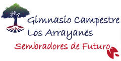
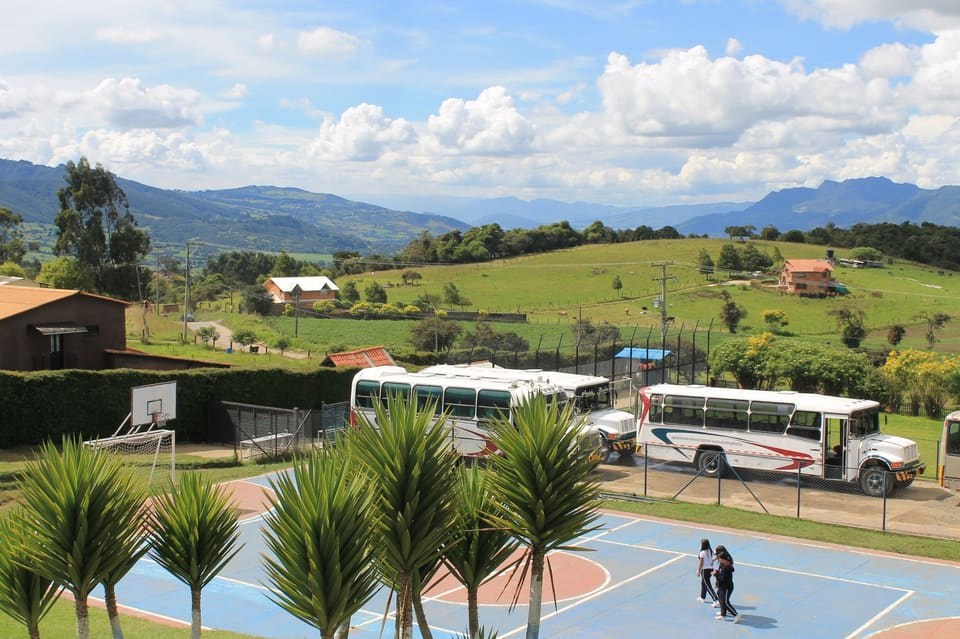

<!doctype html>
<html lang="es-CO">
<head>
  <meta charset="utf-8">
  <meta name="viewport" content="width=device-width, initial-scale=1">
  <title>Gimnasio Campestre Los Arrayanes | Colegio campestre y bilingüe en La Calera</title>
  <meta name="description" content="Colegio campestre, mixto y de calendario A en La Calera, Cundinamarca. Preescolar a 11°, inglés intensivo, francés y STEAM. A minutos de Bogotá, Sopó, Guatavita y Guasca. Agenda tu visita.">
  <meta name="theme-color" content="#20224F">
  
  <!-- PENDIENTE: __SITE_URL__ se reemplaza por el dominio real al publicar (ver README.md) -->
  <link rel="canonical" href="__SITE_URL__/">

  <!-- Open Graph / Twitter -->
  <meta property="og:type" content="website">
  <meta property="og:locale" content="es_CO">
  <meta property="og:site_name" content="Gimnasio Campestre Los Arrayanes">
  <meta property="og:title" content="Gimnasio Campestre Los Arrayanes | Educar para la vida">
  <meta property="og:description" content="Colegio campestre en La Calera: formación holística de Preescolar a 11°, inglés intensivo, francés y STEAM. Agenda tu visita.">
  <meta property="og:url" content="__SITE_URL__/">
  <meta property="og:image" content="__SITE_URL__/img/og-imagen.jpg">
  <meta property="og:image:width" content="1200">
  <meta property="og:image:height" content="630">
  <meta property="og:image:alt" content="Campus del Gimnasio Campestre Los Arrayanes con las montañas de La Calera al fondo">
  <meta name="twitter:card" content="summary_large_image">

  <!-- Iconos y manifest -->
  <link rel="icon" href="favicon.ico" sizes="32x32">
  <link rel="icon" href="icons/icon-192.png" type="image/png" sizes="192x192">
  <link rel="apple-touch-icon" href="icons/apple-touch-icon.png">
  <link rel="manifest" href="manifest.webmanifest">

  <!-- Recursos críticos -->
  <link rel="preload" href="fonts/nunito-sans-var.woff2" as="font" type="font/woff2" crossorigin>
  <link rel="preload" href="fonts/poppins-700.woff2" as="font" type="font/woff2" crossorigin>
  <link rel="preload" as="image" type="image/avif" href="img/instalaciones/instalaciones-11-960.avif" imagesrcset="img/instalaciones/instalaciones-11-480.avif 480w, img/instalaciones/instalaciones-11-960.avif 960w, img/instalaciones/instalaciones-11-1600.avif 1600w, img/instalaciones/instalaciones-11-2200.avif 2200w" imagesizes="100vw" fetchpriority="high">
  <link rel="stylesheet" href="css/styles.css">

  <!-- Datos estructurados (SEO local) -->
  
</head>
<body>
  <a class="saltar" href="#contenido">Saltar al contenido</a>

  <!-- Iconos (sprite SVG). Uso: <svg class="ic"><use href="#i-nombre"/></svg> -->
  <svg width="0" height="0" style="position:absolute" aria-hidden="true" focusable="false">
    <symbol id="i-whatsapp" viewBox="0 0 24 24"><path fill-rule="evenodd" d="M12 2a10 10 0 0 0-8.5 15.2L2 22l4.9-1.4A10 10 0 1 0 12 2Zm0 18.2a8.2 8.2 0 0 1-4.2-1.2l-.3-.2-2.9.8.8-2.8-.2-.3A8.2 8.2 0 1 1 12 20.2Zm4.5-6.1c-.3-.1-1.5-.8-1.7-.9-.2-.1-.4-.1-.6.1-.2.3-.7.9-.8 1-.2.2-.3.2-.6.1-1.5-.8-2.5-1.3-3.5-3-.3-.5.3-.4.8-1.4.1-.2 0-.3 0-.5l-.8-1.9c-.2-.5-.4-.4-.6-.4h-.5c-.2 0-.5.1-.7.3-.3.3-1 1-1 2.4s1 2.8 1.2 3c.1.2 2 3.1 4.9 4.3 1.8.8 2.5.7 3.4.6.6-.1 1.7-.7 1.9-1.4.2-.7.2-1.2.2-1.4-.1-.1-.3-.2-.6-.3Z"/></symbol>
    <symbol id="i-instagram" viewBox="0 0 24 24"><rect x="3" y="3" width="18" height="18" rx="5"/><circle cx="12" cy="12" r="4"/><circle cx="17.5" cy="6.5" r=".6"/></symbol>
    <symbol id="i-mail" viewBox="0 0 24 24"><path d="M4 4h16a2 2 0 0 1 2 2v12a2 2 0 0 1-2 2H4a2 2 0 0 1-2-2V6a2 2 0 0 1 2-2Z"/><path d="m22 6-10 7L2 6"/></symbol>
    <symbol id="i-pin" viewBox="0 0 24 24"><path d="M21 10c0 7-9 13-9 13S3 17 3 10a9 9 0 0 1 18 0Z"/><circle cx="12" cy="10" r="3"/></symbol>
    <symbol id="i-arriba" viewBox="0 0 24 24"><path d="m18 15-6-6-6 6"/></symbol>
    <symbol id="i-abajo" viewBox="0 0 24 24"><path d="m6 9 6 6 6-6"/></symbol>
    <symbol id="i-der" viewBox="0 0 24 24"><path d="m9 18 6-6-6-6"/></symbol>
    <symbol id="i-izq" viewBox="0 0 24 24"><path d="m15 18-6-6 6-6"/></symbol>
    <symbol id="i-cerrar" viewBox="0 0 24 24"><path d="M18 6 6 18M6 6l12 12"/></symbol>
    <symbol id="i-flecha" viewBox="0 0 24 24"><path d="M5 12h14M13 6l6 6-6 6"/></symbol>
    <symbol id="i-play" viewBox="0 0 24 24"><path d="M7 4.5v15l13-7.5Z"/></symbol>
    <symbol id="i-fotos" viewBox="0 0 24 24"><rect x="3" y="5" width="18" height="14" rx="2"/><circle cx="9" cy="10" r="1.5"/><path d="m21 16-5-5-8 8"/></symbol>
    <symbol id="i-idea" viewBox="0 0 24 24"><path d="M9 18h6M10 22h4M12 2a7 7 0 0 0-4 12.7c.6.5 1 1.2 1 2V18h6v-1.3c0-.8.4-1.5 1-2A7 7 0 0 0 12 2Z"/></symbol>
    <symbol id="i-charla" viewBox="0 0 24 24"><path d="M21 11.5a8.4 8.4 0 0 1-9 8.4 8.5 8.5 0 0 1-3.8-.9L3 21l2-5.2A8.4 8.4 0 0 1 12 3a8.4 8.4 0 0 1 9 8.5Z"/></symbol>
    <symbol id="i-grupo" viewBox="0 0 24 24"><path d="M17 21v-2a4 4 0 0 0-4-4H5a4 4 0 0 0-4 4v2M9 11a4 4 0 1 0 0-8 4 4 0 0 0 0 8ZM23 21v-2a4 4 0 0 0-3-3.9M16 3.1a4 4 0 0 1 0 7.8"/></symbol>
    <symbol id="i-chispa" viewBox="0 0 24 24"><path d="M13 2 3 14h9l-1 8 10-12h-9l1-8Z"/></symbol>
    <symbol id="i-persona" viewBox="0 0 24 24"><path d="M20 21v-2a4 4 0 0 0-4-4H8a4 4 0 0 0-4 4v2M12 11a4 4 0 1 0 0-8 4 4 0 0 0 0 8Z"/></symbol>
    <symbol id="i-brujula" viewBox="0 0 24 24"><circle cx="12" cy="12" r="10"/><path d="m16.2 7.8-2.1 6.3-6.3 2.1 2.1-6.3 6.3-2.1Z"/></symbol>
    <symbol id="i-mundo" viewBox="0 0 24 24"><circle cx="12" cy="12" r="10"/><path d="M2 12h20M12 2a15.3 15.3 0 0 1 4 10 15.3 15.3 0 0 1-4 10 15.3 15.3 0 0 1-4-10A15.3 15.3 0 0 1 12 2Z"/></symbol>
    <symbol id="i-hoja" viewBox="0 0 24 24"><path d="M11 20A7 7 0 0 1 9.8 6.1C15.5 5 17 4.5 19 2c1 2 2 4.2 2 8 0 5.5-4.8 10-10 10Z"/><path d="M2 21c0-3 1.9-5.4 5-6"/></symbol>
    <symbol id="i-paleta" viewBox="0 0 24 24"><path d="M12 22a10 10 0 1 1 10-10c0 2.5-2 3-3.5 3H16a2 2 0 0 0-1.5 3.3c.5.6.3 1.7-.5 2.2-.6.3-1.3.5-2 .5Z"/><circle cx="7.5" cy="11" r="1"/><circle cx="10.5" cy="7" r="1"/><circle cx="15.5" cy="7.5" r="1"/></symbol>
    <symbol id="i-corazon" viewBox="0 0 24 24"><path d="M20.8 4.6a5.5 5.5 0 0 0-7.8 0L12 5.7l-1-1.1a5.5 5.5 0 0 0-7.8 7.8l1 1.1L12 21.2l7.8-7.7 1-1.1a5.5 5.5 0 0 0 0-7.8Z"/></symbol>
    <symbol id="i-libro" viewBox="0 0 24 24"><path d="M4 19.5A2.5 2.5 0 0 1 6.5 17H20"/><path d="M6.5 2H20v20H6.5A2.5 2.5 0 0 1 4 19.5v-15A2.5 2.5 0 0 1 6.5 2Z"/></symbol>
    <symbol id="i-maletin" viewBox="0 0 24 24"><rect x="2" y="7" width="20" height="14" rx="2"/><path d="M16 21V5a2 2 0 0 0-2-2h-4a2 2 0 0 0-2 2v16"/></symbol>
    <symbol id="i-llave" viewBox="0 0 24 24"><path d="M14.7 6.3a1 1 0 0 0 0 1.4l1.6 1.6a1 1 0 0 0 1.4 0l3.8-3.8a6 6 0 0 1-7.9 7.9l-6.9 6.9a2.1 2.1 0 0 1-3-3l6.9-6.9a6 6 0 0 1 7.9-7.9l-3.8 3.8Z"/></symbol>
    <symbol id="i-mas" viewBox="0 0 24 24"><circle cx="12" cy="12" r="10"/><path d="M12 8v8M8 12h8"/></symbol>
    <symbol id="i-escudo" viewBox="0 0 24 24"><path d="M12 22s8-4 8-10V5l-8-3-8 3v7c0 6 8 10 8 10Z"/></symbol>
    <symbol id="i-bandera" viewBox="0 0 24 24"><path d="M4 22V4M4 4h13l-2 4 2 4H4"/></symbol>
    <symbol id="i-estrella" viewBox="0 0 24 24"><path d="m12 2 3.1 6.3 6.9 1-5 4.9 1.2 6.8L12 17.7 5.8 21l1.2-6.8-5-4.9 6.9-1L12 2Z"/></symbol>
    <symbol id="i-marcar" viewBox="0 0 24 24"><path d="M20 6 9 17l-5-5"/></symbol>
    <symbol id="i-cohete" viewBox="0 0 24 24"><path d="M4.5 16.5c-1.5 1.3-2 5-2 5s3.7-.5 5-2c.7-.8.7-2.1-.1-2.9a2.1 2.1 0 0 0-2.9-.1ZM12 15l-3-3a22 22 0 0 1 2-3.9A12.9 12.9 0 0 1 22 2c0 2.7-.8 7.5-6 11a22 22 0 0 1-4 2Z"/><path d="M9 12H4s.6-3 2-4c1.6-1.1 5 0 5 0M12 15v5s3-.6 4-2c1.1-1.6 0-5 0-5"/></symbol>
  </svg>

  <!-- ===================== HEADER ===================== -->
  <header class="cabecera" id="cabecera">
    

      <a class="logo" href="#inicio" aria-label="Gimnasio Campestre Los Arrayanes, ir al inicio">
        <picture>
          <source type="image/webp" srcset="img/logo/logo-240.webp">
          
        </picture>
      </a>

      <nav class="menu" id="menu" aria-label="Navegación principal">
        <ul>
          <li><a href="#inicio">Inicio</a></li>
          <li><a href="#historia">Nuestra historiaHistoria</a></li>
          <li><a href="#instalaciones">Instalaciones</a></li>
          <li><a href="#por-que-arrayanes">Por qué ArrayanesPor qué GCA</a></li>
          <li><a href="#equipo">Nuestro equipoEquipo</a></li>
          <li><a href="#proyecto-educativo">Proyecto educativoProyecto</a></li>
          <li><a href="#experiencias">Experiencias</a></li>
          <li><a href="#convivencia">Convivencia escolarConvivencia</a></li>
          <li><a href="#secciones-academicas">Secciones académicasSecciones</a></li>
          <li><a href="#creaciones">Nuestras creacionesCreaciones</a></li>
          <li class="menu-cta"><a class="btn btn-acento btn-sm" href="#admisiones">Admisiones</a></li>
        </ul>
      </nav>

      <button class="menu-boton" id="menu-boton" type="button" aria-expanded="false" aria-controls="menu" aria-label="Abrir menú">
        
      </button>
    

  </header>

  <main id="contenido">

    <!-- ===================== INICIO / HERO ===================== -->
    <section class="hero" id="inicio" aria-labelledby="hero-titulo">
      <picture class="hero-foto">
        <source type="image/avif" srcset="img/instalaciones/instalaciones-11-480.avif 480w, img/instalaciones/instalaciones-11-960.avif 960w, img/instalaciones/instalaciones-11-1600.avif 1600w, img/instalaciones/instalaciones-11-2200.avif 2200w" sizes="100vw">
        <source type="image/webp" srcset="img/instalaciones/instalaciones-11-480.webp 480w, img/instalaciones/instalaciones-11-960.webp 960w, img/instalaciones/instalaciones-11-1600.webp 1600w, img/instalaciones/instalaciones-11-2200.webp 2200w" sizes="100vw">
        
      </picture>
      

      

        
Sembradores de futuro · La Calera, Cundinamarca

        <h1 id="hero-titulo">Educar para la vida, en el corazón de la naturaleza</h1>
        
Colegio campestre, mixto y de calendario A. Formación holística de Preescolar a 11°, con inglés intensivo, francés y STEAM.

        

          <a class="btn btn-claro btn-lg" href="#quienes-somos">Conoce nuestro colegio</a>
          <a class="btn btn-acento btn-lg" href="#admisiones">Admisiones</a>
        

      

      <a class="hero-bajar" href="#quienes-somos" aria-label="Bajar a la siguiente sección"><svg class="ic"><use href="#i-abajo"/></svg></a>
    </section>

    <!-- ===================== QUIÉNES SOMOS ===================== -->
    <section class="seccion" id="quienes-somos" aria-labelledby="quienes-titulo">
      

        

          
Quiénes somos

          <h2 id="quienes-titulo">Un lugar para aprender, explorar y crecer en contacto con la naturaleza</h2>
          
Somos una institución educativa privada, mixta y de calendario A, ubicada en un entorno campestre privilegiado de La Calera, Cundinamarca, en la vereda San José La Concepción, que ofrece a nuestros estudiantes espacios para aprender, explorar, compartir y crecer en contacto con la naturaleza.

          
Ofrecemos una formación holística en Preescolar, Primaria, Secundaria y Media Académica, en jornada completa, con un programa de inglés intensivo y una propuesta educativa orientada al desarrollo académico, humano, social y emocional de nuestros estudiantes.

          
Nuestro propósito es acompañar a cada estudiante en el desarrollo de su potencial, fortaleciendo la autonomía, la creatividad, el liderazgo, la convivencia y el aprendizaje permanente, para que pueda desenvolverse con confianza y responsabilidad en un mundo en constante transformación.

          <blockquote class="cita">En el Gimnasio Campestre Los Arrayanes creemos que educar significa mucho más que transmitir conocimientos. Significa formar personas capaces de comprender, pensar, crear, convivir y transformar su entorno.</blockquote>
        

        

          <!-- Fotos: cambia el id en data-foto (ver img/_mapa-fotos.txt) -->
          

          

          

        

      

      <!-- Datos destacados -->
      

        <ul class="cifras rv" aria-label="Datos destacados">
          <li><strong class="cifra">2006</strong>Año de fundación</li>
          <li><strong class="cifra">+20</strong>Años formando personas</li>
          <li><strong class="cifra cifra-texto">Preescolar a 11°</strong>Jornada completa</li>
          <li><strong class="cifra cifra-texto">Inglés intensivo y francés</strong>Visión global e intercultural</li>
          <li><strong class="cifra">20.000 m²</strong>De campus en medio del verde</li>
        </ul>
      

    </section>

    <!-- ===================== NUESTRA HISTORIA ===================== -->
    <section class="seccion seccion-alt" id="historia" aria-labelledby="historia-titulo">
      

        <header class="seccion-cab rv">
          
Nuestra historia

          <h2 id="historia-titulo">Una idea que nació en La Calera y que llegó mucho más lejos</h2>
        </header>

        <ol class="linea">
          <li class="hito rv">
            2006
            

              <h3>Nace el Gimnasio Campestre Los Arrayanes</h3>
              
En 2006 nació el Gimnasio Campestre Los Arrayanes con un propósito claro: ofrecer a las familias una alternativa educativa diferente, cercana y de alta calidad.

              
Comenzamos nuestro camino con apenas 7 salones, 7 maestros y 90 estudiantes. Éramos una institución pequeña, pero teníamos una gran convicción: que educar significa mucho más que transmitir conocimientos; significa formar personas capaces de pensar, comprender, liderar y transformar su realidad.

              <ul class="chips"><li>7 salones</li><li>7 maestros</li><li>90 estudiantes</li></ul>
            

          </li>
          <li class="hito rv">
            2007
            

              <h3>Una acogida extraordinaria</h3>
              
La respuesta de las familias fue extraordinaria. Nuestro proyecto educativo tuvo una gran acogida y, desde los primeros años, el colegio comenzó a crecer de manera significativa. En 2007 llegamos a 346 estudiantes, consolidando una comunidad que compartía nuestra visión de una educación diferente.

              <ul class="chips"><li>346 estudiantes</li></ul>
            

          </li>
          <li class="hito rv">
            2009
            

              <h3>Los primeros Arrayanistas que abrieron el camino</h3>
              
En 2009 vivimos uno de los momentos más importantes de nuestra historia: se graduó nuestra primera promoción de bachilleres.

              
Fueron 15 jóvenes que, junto con sus familias, se convirtieron en los primeros egresados de una historia que apenas comenzaba. Ellos abrieron el camino para las generaciones que vendrían después y llevaron consigo el nombre de Los Arrayanes más allá de nuestras aulas.

              <ul class="chips"><li>Primera promoción</li><li>15 bachilleres</li></ul>
            

          </li>
          <li class="hito rv">
            2010
            

              <h3>Resultados destacados en las pruebas de Estado</h3>
              
En 2010, nuestra segunda promoción obtuvo resultados destacados en las pruebas de Estado, reafirmando nuestro compromiso con una formación académica sólida y de calidad.

            

          </li>
          <li class="hito hito-hoy rv">
            Hoy
            

              <h3>Una comunidad que creció más allá de La Calera</h3>
              
Con el paso de los años, la confianza de las familias fue haciendo crecer nuestra comunidad Arrayanista.

              
Hoy, después de dos décadas, nuestro colegio recibe estudiantes no solamente de La Calera, sino también de Bogotá y de municipios vecinos como Sopó, Guatavita y Guasca, entre otros.

              <ul class="chips chips-lugares" aria-label="Municipios de procedencia de nuestras familias"><li>La Calera</li><li>Bogotá</li><li>Sopó</li><li>Guatavita</li><li>Guasca</li></ul>
              
Este crecimiento representa mucho más que el aumento en el número de estudiantes. Para nosotros significa que familias de diferentes lugares encuentran en Los Arrayanes una propuesta educativa en la que confían para acompañar el presente y el futuro de sus hijos.

              
Cada familia que llega se convierte en parte de una comunidad que ha construido su historia a través de la confianza, el compromiso y el deseo de ofrecer a los niños y jóvenes una educación con propósito.

            

          </li>
        </ol>

        

          <article class="panel panel-azul rv">
            <h3>Crecer sin perder nuestra esencia</h3>
            
A medida que crecimos, también evolucionó nuestra propuesta educativa.

            
Desde nuestros primeros años entendimos que los estudiantes no debían limitarse a memorizar información, sino que necesitaban comprenderla, cuestionarla, relacionarla con su realidad y utilizarla para resolver situaciones de la vida.

            
Por eso, la Enseñanza para la Comprensión se convirtió en uno de los pilares de nuestro proyecto pedagógico:

            
Aprender para comprender, comprender para actuar y actuar para transformar.

            
Nuestra propuesta también ha evolucionado para responder a los desafíos de un mundo en constante transformación, fortaleciendo los idiomas, la ciencia y la tecnología, el pensamiento crítico, el arte, el deporte, la innovación, la sostenibilidad y las habilidades socioemocionales.

          </article>

          <article class="panel panel-vino rv">
            <h3>20 años construyendo futuro</h3>
            
Han pasado dos décadas desde aquel 2006 y el Gimnasio Campestre Los Arrayanes continúa creciendo y transformándose.

            
Nuestra historia no está solamente en los salones que construimos, en las promociones que se han graduado o en los estudiantes que han pasado por nuestras aulas.

            <ul class="versos">
              <li>Está en cada familia que confió en nosotros.</li>
              <li>En cada docente que dejó una huella.</li>
              <li>En cada estudiante que descubrió su potencial.</li>
              <li>Y en cada Arrayanista que hoy lleva nuestra historia consigo.</li>
            </ul>
            
Hoy seguimos mirando hacia el futuro con el mismo espíritu con el que comenzamos: <strong>educar para la vida</strong>. Porque el mundo cambia y nosotros también evolucionamos con él.

            
Nuestro compromiso es seguir formando estudiantes capaces de comprender el mundo, desarrollar su propósito, afrontar sus desafíos y aportar a la construcción de una sociedad mejor.

          </article>
        

      

    </section>

    <!-- ===================== NUESTRAS INSTALACIONES ===================== -->
    <section class="seccion" id="instalaciones" aria-labelledby="instalaciones-titulo">
      

        <header class="seccion-cab rv">
          
Nuestras instalaciones

          <h2 id="instalaciones-titulo">20.000 metros de verde intenso, aire puro y cielo azul</h2>
          
Un espacio ideal y óptimo que permite el equilibrio perfecto, evita la masificación y preserva el paisaje: 20.000 metros de verde intenso, aire puro, cielo azul y sana convivencia.

        </header>

        

        <!-- Video de recorrido: la URL se configura en js/config.js (videos.recorrido) -->
        

          

          <button class="video-play" type="button" aria-label="Reproducir el video del recorrido por nuestras instalaciones">
            <svg class="ic ic-relleno"><use href="#i-play"/></svg>
            Recorre el campus en video
          </button>
        

      

    </section>

    <!-- ===================== POR QUÉ ARRAYANES ===================== -->
    <section class="seccion seccion-alt" id="por-que-arrayanes" aria-labelledby="porque-titulo">
      

        <header class="seccion-cab rv">
          
Por qué Arrayanes

          <h2 id="porque-titulo">Una comunidad comprometida con el potencial humano de cada estudiante</h2>
        </header>

        

          <article class="tarjeta tarjeta-grande rv" id="mision">
            <h3>Misión</h3>
            
El Colegio GIMNASIO CAMPESTRE LOS ARRAYANES es una comunidad educativa comprometida con cada uno de los estudiantes en el cultivo de su potencial humano, para lograr el liderazgo de su propia vida, su contribución a la transformación de la sociedad y al cuidado de la naturaleza. Para lograrlo, el proyecto educativo institucional se basa en la formación holística; el compromiso social y liderazgo de servicio; la excelencia académica fundamentada en el pensamiento crítico y en una actitud de aprendizaje permanente; una visión global e intercultural y la innovación y el emprendimiento social. Estamos comprometidos con la educación de ciudadanos globales, incluyentes, respetuosos de las demás personas y de la diferencia.

          </article>
          <article class="tarjeta tarjeta-grande tarjeta-vino rv" id="vision">
            <h3>Visión</h3>
            
El GCA será reconocido como un colegio:

            <ul class="lista-check">
              <li>Líder en proyectos de innovación y emprendimiento social.</li>
              <li>Con proyección internacional de sus estudiantes sin descuidar el compromiso con su país.</li>
              <li>Referente en la convivencia restaurativa y la resiliencia espiritual.</li>
              <li>Modelo de prácticas de desarrollo sostenible en la protección del medio ambiente.</li>
            </ul>
            
Lo anterior, al tiempo en que logra un balance entre la calidad académica y el cultivo del potencial humano de sus estudiantes, convirtiéndose en líder al ser referente entre instituciones educativas a nivel nacional por sus prácticas pedagógicas.

          </article>
        

        <h3 class="subtitulo rv" id="principios">Nuestros principios</h3>
        

          <article class="tarjeta rv">
            1
            <h4>Conflicto</h4>
            
El colegio no entiende el conflicto simplemente como algo negativo que debe evitarse, sino como una oportunidad de aprendizaje, crecimiento, confrontación, reflexión y construcción de convivencia. Se promueve la participación, el diálogo, la discusión, la búsqueda de acuerdos y la reparación.

            
Transformamos las dificultades en oportunidades para aprender, dialogar y crecer.

          </article>
          <article class="tarjeta rv">
            2
            <h4>Comunicación</h4>
            
La comunicación es entendida como una herramienta para la convivencia. Implica escuchar diferentes perspectivas, comprenderlas, retroalimentarlas y buscar acuerdos, aun cuando existan desacuerdos.

            
Aprendemos a escuchar y dialogar. Reconocemos diferentes perspectivas y construimos acuerdos.

          </article>
          <article class="tarjeta rv">
            3
            <h4>Verdad</h4>
            
La verdad surge de un adecuado proceso de comunicación y del análisis de las diferentes perspectivas. Implica comprender los hechos, las circunstancias, las responsabilidades y las situaciones que rodean un conflicto.

            
Buscamos comprender antes de juzgar. La verdad se construye escuchando, analizando y comprendiendo las diferentes perspectivas.

          </article>
          <article class="tarjeta rv">
            4
            <h4>Restauración</h4>
            
La restauración busca restablecer las relaciones, reconocer las faltas y sus consecuencias y reparar los daños causados. El colegio se distancia de una visión basada exclusivamente en el castigo y privilegia la reflexión, la responsabilidad y la reparación.

            
Restauramos para volver a construir. Educamos para reconocer, reparar, aprender y fortalecer las relaciones.

          </article>
          <article class="tarjeta rv">
            5
            <h4>Particularidad</h4>
            
El colegio reconoce que cada persona enfrenta los conflictos y las situaciones de manera diferente, de acuerdo con su historia, contexto, experiencias y forma de interpretar lo ocurrido.

            
Cada estudiante es único. Reconocemos su historia, sus características, sus fortalezas y su manera particular de aprender y crecer.

          </article>
        

        
Así se viven estos principios en el día a día: <a href="#convivencia">conoce nuestra convivencia escolar</a>.

        <h3 class="subtitulo rv" id="perfil">Perfil del estudiante</h3>
        <blockquote class="cita cita-centro rv">&ldquo;Mujeres y hombres íntegros preparados para los desafíos con conocimientos, valor y confianza, que transforman la sociedad.&rdquo;</blockquote>
        

          <article class="tarjeta tarjeta-icono rv"><svg class="ic"><use href="#i-idea"/></svg><h4>Piensa</h4>
Pregunta, analiza, argumenta, crea, innova y resuelve.
</article>
          <article class="tarjeta tarjeta-icono rv"><svg class="ic"><use href="#i-charla"/></svg><h4>Se comunica</h4>
Escucha, comprende, expresa sus ideas, dialoga, domina el inglés y el francés.
</article>
          <article class="tarjeta tarjeta-icono rv"><svg class="ic"><use href="#i-grupo"/></svg><h4>Convive</h4>
Respeta, reconoce al otro, coopera y cuida el ambiente.
</article>
          <article class="tarjeta tarjeta-icono rv"><svg class="ic"><use href="#i-chispa"/></svg><h4>Transforma</h4>
Tiene compromiso social, propone, lidera y sirve a los demás.
</article>
          <article class="tarjeta tarjeta-icono rv"><svg class="ic"><use href="#i-persona"/></svg><h4>Se conoce</h4>
Reconoce su potencial, construye su identidad, desarrolla sus talentos.
</article>
          <article class="tarjeta tarjeta-icono rv"><svg class="ic"><use href="#i-brujula"/></svg><h4>Construye su futuro</h4>
Se fija metas, persevera, toma decisiones y emprende.
</article>
        

      

    </section>

    <!-- ===================== NUESTRO EQUIPO ===================== -->
    <!-- Para agregar una foto a un rol: reemplaza el ... por
          -->
    <section class="seccion" id="equipo" aria-labelledby="equipo-titulo">
      

        <header class="seccion-cab rv">
          
Nuestro equipo

          <h2 id="equipo-titulo">Personas que acompañan la formación integral de cada estudiante</h2>
          
Nuestro equipo de trabajo está conformado por profesionales y colaboradores que, desde sus diferentes roles y responsabilidades, aportan de manera articulada a la formación integral, el bienestar y el desarrollo de nuestros estudiantes.

        </header>

        

          <article class="rol rv">
            <svg class="ic"><use href="#i-maletin"/></svg>
            <h3>Dirección Administrativa</h3>
            
Profesional encargada de gestionar los recursos financieros, operativos, procesos de contratación, la atención a las familias, garantizando la sostenibilidad y el adecuado funcionamiento de la institución.

          </article>
          <article class="rol rv">
            <svg class="ic"><use href="#i-brujula"/></svg>
            <h3>Rectoría</h3>
            
Profesional que lidera el Proyecto Educativo Institucional, crea, planea y ejecuta todos los proyectos académicos, convivenciales y axiológicos de la institución, dirige y orienta la labor docente y promueve el bienestar general.

          </article>
          <article class="rol rv">
            <svg class="ic"><use href="#i-libro"/></svg>
            <h3>Coordinación Académica</h3>
            
Profesional encargado de planificar, dirigir y supervisar los procesos académicos y pedagógicos de la institución.

          </article>
          <article class="rol rv">
            <svg class="ic"><use href="#i-grupo"/></svg>
            <h3>Coordinación Convivencial</h3>
            
Profesional directivo docente, encargado de gestionar, orientar y fortalecer el clima institucional y la resolución práctica de conflictos en la institución.

          </article>
          <article class="rol rv">
            <svg class="ic"><use href="#i-llave"/></svg>
            <h3>Dirección Operativa</h3>
            
Dependencia encargada del mantenimiento locativo de la institución; se dedica a la adecuación de cada espacio y de los enseres para que cumplan con todas las condiciones de máxima calidad necesarias para el desarrollo y bienestar de los estudiantes. Así mismo, revisa y ejerce el cuidado de las rutas escolares y del grupo humano de conductores y monitoras del plantel, para que cumplan de manera seria y responsable con sus obligaciones con estudiantes y padres de familia.

          </article>
          <article class="rol rv">
            <svg class="ic"><use href="#i-idea"/></svg>
            <h3>Gestores de ambientes de aprendizaje</h3>
            
Lideran ambientes de aprendizaje significativos, innovadores e inclusivos, mediante la planeación, organización, acompañamiento y seguimiento de los procesos académicos y pedagógicos de sus respectivas áreas. Promueven el trabajo colaborativo y el mejoramiento continuo de las prácticas docentes, diseñando experiencias que conecten los conocimientos con la exploración, la creatividad, la investigación, la naturaleza y las necesidades e intereses de los estudiantes, para favorecer aprendizajes profundos, pertinentes y con sentido.

          </article>
          <article class="rol rv">
            <svg class="ic"><use href="#i-estrella"/></svg>
            <h3>Docentes</h3>
            
Acompañan directamente el proceso de formación de los estudiantes. Planifican y desarrollan experiencias de aprendizaje, realizan seguimiento académico y formativo, fortalecen las habilidades y talentos de cada niño y joven, y construyen relaciones basadas en el respeto y la confianza.

          </article>
        

        <h3 class="subtitulo rv">Bienestar</h3>
        

          <article class="rol rol-vino rv">
            <svg class="ic"><use href="#i-corazon"/></svg>
            <h3>Psicología</h3>
            
Brindar acompañamiento y orientación psicológica a los estudiantes, promoviendo su desarrollo emocional, social y personal, así como relaciones interpersonales basadas en el respeto, la empatía, la inclusión y la valoración de la diferencia. Realizar procesos de orientación, valoración y seguimiento individual y grupal para identificar oportunamente necesidades psicológicas, emocionales, sociales, académicas o educativas, y desarrollar estrategias de promoción, prevención, intervención y seguimiento, en articulación con estudiantes, familias, docentes y directivos, contribuyendo al bienestar integral, la convivencia escolar y el adecuado desarrollo de los procesos de aprendizaje.

          </article>
          <article class="rol rol-vino rv">
            <svg class="ic"><use href="#i-mas"/></svg>
            <h3>Enfermería</h3>
            
Ofrece atención básica y acompañamiento en situaciones relacionadas con la salud y el bienestar de los estudiantes y colaboradores. También apoya las acciones de promoción de hábitos saludables, prevención y atención oportuna de acuerdo con los protocolos institucionales.

          </article>
        

        <h3 class="subtitulo rv">Otros servicios</h3>
        <article class="rol rol-ancho rv">
          <svg class="ic"><use href="#i-escudo"/></svg>
          

            <h4>Servicios generales y de apoyo</h4>
            
Contribuyen al adecuado funcionamiento de la institución mediante el apoyo con actividades logísticas, de mantenimiento, limpieza, organización, seguridad y conservación de los espacios institucionales, garantizando ambientes agradables, higiénicos, seguros, organizados y adecuados para el aprendizaje, la convivencia y el desarrollo de los proyectos y servicios institucionales.

          

        </article>
      

    </section>

    <!-- ===================== PROYECTO EDUCATIVO ===================== -->
    <section class="seccion seccion-alt" id="proyecto-educativo" aria-labelledby="proyecto-titulo">
      

        <header class="seccion-cab rv">
          
Proyecto educativo

          <h2 id="proyecto-titulo">Aprendemos para comprender, pensamos para transformar</h2>
          
En el Gimnasio Campestre Los Arrayanes entendemos la educación como un proceso que va más allá de aprender contenidos. Buscamos que cada estudiante comprenda, piense, participe, cree y encuentre sentido a lo que aprende, desarrollando todo su potencial.

          
Nuestra propuesta integra diferentes enfoques y metodologías que fortalecen el aprendizaje y la formación integral.

        </header>

        <h3 class="subtitulo rv">Así aprendemos en el GCA</h3>
        

          <article class="tarjeta tarjeta-icono rv">
            <svg class="ic"><use href="#i-idea"/></svg>
            <h4>Enseñanza para la Comprensión</h4>
            
Aprender no es memorizar, es comprender y saber utilizar lo aprendido. Nuestro estudiante aprende a través de preguntas, experiencias, proyectos y situaciones reales. Buscamos que pueda explicar, relacionar, aplicar y utilizar sus conocimientos en nuevos contextos, convirtiendo el aprendizaje en una herramienta para la vida.

          </article>
          <article class="tarjeta tarjeta-icono rv">
            <svg class="ic"><use href="#i-cohete"/></svg>
            <h4>Aprendizaje activo, experiencial y significativo</h4>
            
Un enfoque educativo donde el estudiante deja de ser un receptor pasivo y construye su propio conocimiento, mediante la acción, la vivencia directa y la conexión con saberes previos.

            <ul class="chips">
              <li>Estudiante protagonista</li>
              <li>Docente gestor y guía</li>
              <li>Conexión con la realidad</li>
              <li>Reflexión estructurada</li>
            </ul>
          </article>
          <article class="tarjeta tarjeta-icono rv">
            <svg class="ic"><use href="#i-llave"/></svg>
            <h4>Aprendizaje Basado en Problemas (ABP)</h4>
            
Los estudiantes aprenden y desarrollan competencias mediante la resolución de problemas.

          </article>
          <article class="tarjeta tarjeta-icono rv">
            <svg class="ic"><use href="#i-grupo"/></svg>
            <h4>Aprendizaje cooperativo y colaborativo</h4>
            
Metodologías activas de trabajo en grupo que buscan construir conocimientos de forma conjunta con estructuras organizadas.

          </article>
          <article class="tarjeta tarjeta-icono rv">
            <svg class="ic"><use href="#i-estrella"/></svg>
            <h4>Gamificación</h4>
            
Se aplican elementos y mecánicas de juegos en entornos de aprendizaje, con el objetivo de aumentar el interés y la retención de conocimientos en los estudiantes mediante retos y narrativas.

          </article>
          <article class="tarjeta tarjeta-icono rv">
            <svg class="ic"><use href="#i-flecha"/></svg>
            <h4>Flipped Classroom</h4>
            
Un modelo donde los estudiantes estudian los contenidos teóricos en casa, a través de materiales como videos, lecturas y presentaciones interactivas, mientras que en clase se llevan a cabo ejercicios, debates, proyectos, actividades prácticas que refuerzan lo aprendido y resolución de dudas con guía del docente.

          </article>
          <article class="tarjeta tarjeta-icono tarjeta-ancha rv">
            <svg class="ic"><use href="#i-mundo"/></svg>
            <h4>Inglés y francés</h4>
            
Los idiomas son un eje fundamental de nuestra propuesta educativa. Promovemos el aprendizaje intensivo del inglés desde Preescolar hasta grado once y la enseñanza del francés desde Primaria hasta grado once. Desde la primera infancia, nuestros estudiantes desarrollan progresivamente sus competencias comunicativas en las cuatro habilidades del inglés: Listening, Speaking, Reading &amp; Writing, fortaleciendo su confianza para comunicarse en otros idiomas y desenvolverse en un mundo global e intercultural.

          </article>
        

        <article class="steam rv" aria-labelledby="steam-titulo">
          

            <h3 id="steam-titulo">STEAM</h3>
            
Modelo pedagógico que une las áreas de ciencia, tecnología, ingeniería, arte y matemáticas para resolver problemas.

          

          <ul class="steam-letras">
            <li>S<strong>Ciencias</strong>Ayuda a entender el mundo</li>
            <li>T<strong>Tecnología</strong>Herramientas digitales</li>
            <li>E<strong>Ingeniería</strong>Diseña y construye soluciones</li>
            <li>A<strong>Artes</strong>Fomenta creatividad, diseño y visión humanista</li>
            <li>M<strong>Matemáticas</strong>Permite calcular, medir y analizar</li>
          </ul>
        </article>

        <h3 class="subtitulo rv" id="principios-academicos">Principios académicos</h3>
        

          <article class="tarjeta rv">
            <h4>Excelencia académica</h4>
            
No se limita a conocimientos; desarrolla capacidades éticas, cognitivas, comunicativas, afectivas, psicomotrices, interpersonales y de compromiso social, incluyendo pensamiento crítico, creatividad, liderazgo, investigación y participación democrática.

          </article>
          <article class="tarjeta rv">
            <h4>Formación holística</h4>
            
Busca desarrollar al estudiante de manera integral, comprendiendo a la persona y su entorno, articulando dimensiones cognitivas, afectivas, sociales, espirituales, corporales y estéticas. También destaca el diálogo, el debate, la fraternidad y la coherencia entre lo que somos, pensamos, decimos y hacemos.

          </article>
          <article class="tarjeta rv">
            <h4>Construcción de valores</h4>
            
El estudiante es entendido como sujeto activo en la construcción de valores, buscando autonomía mediante respeto, responsabilidad, honestidad, tolerancia, diálogo, creatividad, paz, justicia, solidaridad y amistad.

          </article>
          <article class="tarjeta rv">
            <h4>Compromiso social y liderazgo de servicio</h4>
            
Busca que el estudiante comprenda su responsabilidad como miembro de la comunidad local, nacional e internacional y participe en acciones que contribuyan a construir estructuras sociales más justas.

          </article>
          <article class="tarjeta rv">
            <h4>Pensamiento crítico</h4>
            
Enseñamos a pensar, no solo a responder. Nuestros estudiantes aprenden a preguntar, cuestionar, analizar, argumentar, tomar decisiones y proponer soluciones. Los invitamos a observar diferentes perspectivas, construir sus propias ideas y participar activamente en la transformación de su entorno.

          </article>
          <article class="tarjeta rv">
            <h4>Visión global e intercultural</h4>
            
Busca desarrollar competencias académicas y comunicativas en inglés y francés con una visión universal que permita comprender otras culturas y diferentes perspectivas sobre el mundo.

          </article>
        

      

    </section>

    <!-- ===================== EXPERIENCIAS ===================== -->
    <section class="seccion" id="experiencias" aria-labelledby="experiencias-titulo">
      

        <header class="seccion-cab rv">
          
Experiencias que complementan nuestro aprendizaje

          <h2 id="experiencias-titulo">Aprendemos viviendo, explorando y descubriendo el mundo</h2>
        </header>

        

          <article class="tarjeta tarjeta-icono rv">
            <svg class="ic"><use href="#i-chispa"/></svg>
            <h3 class="h4">Clarity Lab</h3>
            
Espacio para explorar, desarrollar ideas y fortalecer habilidades de pensamiento e innovación.

          </article>
          <article class="tarjeta tarjeta-icono rv">
            <svg class="ic"><use href="#i-corazon"/></svg>
            <h3 class="h4">Harmony Day <small>(Día de la armonía)</small></h3>
            
Una celebración en el colegio dedicada a promover la diversidad cultural, emocional, el respeto y la inclusión entre los estudiantes.

          </article>
          <article class="tarjeta tarjeta-icono rv">
            <svg class="ic"><use href="#i-paleta"/></svg>
            <h3 class="h4">Arte y cultura</h3>
            
El arte y la cultura son espacios para que nuestros estudiantes descubran sus talentos, desarrollen su creatividad y encuentren diferentes formas de expresar sus ideas, emociones y maneras de comprender el mundo. A través de la música, la danza, las artes plásticas, el teatro y otras manifestaciones culturales, fortalecemos la sensibilidad, la imaginación, la confianza y la capacidad de apreciar y respetar diferentes expresiones culturales. Estas experiencias permiten que cada estudiante explore, cree, comunique y descubra nuevas posibilidades, enriqueciendo su formación académica y humana.

          </article>
        

        

          <header class="seccion-cab rv">
            
Escuelas extracurriculares

            <h3 class="h2">After Class Club</h3>
          </header>

          

            <article class="escuela rv">
              <h4>Escuela de STEAM y Robótica</h4>
              
Crear soluciones para el futuro

              
La Robótica y las experiencias STEAM acercan a nuestros estudiantes a la ciencia, la tecnología, la ingeniería, el arte y las matemáticas de una manera práctica y divertida. A través de retos y proyectos, aprenden a crear, experimentar, resolver problemas y trabajar colaborativamente, desarrollando competencias necesarias para enfrentar los desafíos del futuro.

            </article>
            <article class="escuela escuela-vino rv">
              <h4>Escuela de Música</h4>
              
Descubrir, crear y expresar

              
La música es un espacio para descubrir talentos, desarrollar la sensibilidad y expresar emociones. Nuestra Escuela de Música permite a los estudiantes acercarse al lenguaje musical de manera práctica, creativa y significativa. A través de la exploración de diferentes instrumentos, el canto, el ritmo y la interpretación, los estudiantes fortalecen la disciplina, la concentración, la memoria, la coordinación, la creatividad y el trabajo en equipo. La música también se convierte en una oportunidad para compartir y crecer junto a otros mediante presentaciones, ensambles y experiencias musicales, fortaleciendo la confianza y el sentido de pertenencia a nuestra comunidad Arrayanista.

            </article>
            <article class="escuela rv">
              <h4>Escuelas de Voleibol y Fútbol</h4>
              
En Los Arrayanes entendemos el deporte como una herramienta fundamental para la formación holística. A través de la práctica deportiva, nuestros estudiantes desarrollan disciplina, responsabilidad, perseverancia y hábitos de vida saludable, mientras aprenden a reconocer sus fortalezas y superar sus propios desafíos. El deporte también fortalece el trabajo en equipo, el respeto, la solidaridad, el liderazgo y el manejo de las emociones, enseñando que ganar y perder hacen parte del aprendizaje. Más que formar deportistas, buscamos formar estudiantes que comprendan el valor del esfuerzo, la constancia, el compañerismo y la superación personal.

            </article>
            <article class="escuela escuela-vino rv">
              <h4>Preparación para la Primera Comunión</h4>
              
Brinda a los estudiantes y sus familias un espacio de formación en experiencias que fortalecen sus valores, su dimensión espiritual, reflexión y acompañamiento, promoviendo valores como el amor, el respeto, la solidaridad, el servicio y la convivencia.

            </article>
          

          <h4 class="subtitulo rv">Galería: STEAM y Robótica</h4>
          

          <h4 class="subtitulo rv">Galería: Voleibol y fútbol</h4>
          

        

      

    </section>

    <!-- ===================== CONVIVENCIA ESCOLAR ===================== -->
    <section class="seccion seccion-azul" id="convivencia" aria-labelledby="convivencia-titulo">
      

        <header class="seccion-cab rv">
          
Convivencia escolar

          <h2 id="convivencia-titulo">Justicia restaurativa</h2>
          
En el Gimnasio Campestre Los Arrayanes entendemos la convivencia como una oportunidad para aprender, crecer y fortalecer las relaciones. Nuestra disciplina tiene un enfoque formativo, basado en los siguientes pilares:

        </header>

        <ol class="ruta">
          <li class="ruta-paso rv">
            1
            <h3>Conflicto</h3>
            
Una oportunidad para aprender

            
Reconocemos que los conflictos hacen parte de la vida y del proceso de crecimiento. Los entendemos como oportunidades para dialogar, reflexionar, construir acuerdos y fortalecer la convivencia.

          </li>
          <li class="ruta-paso rv">
            2
            <h3>Comunicación</h3>
            
Escuchar para comprender

            
Promovemos el diálogo respetuoso, la escucha activa y la participación de todas las personas involucradas, buscando comprender diferentes perspectivas y construir soluciones conjuntas.

          </li>
          <li class="ruta-paso rv">
            3
            <h3>Verdad</h3>
            
Comprender los hechos

            
Buscamos conocer los hechos de manera objetiva, escuchando todas las voces, identificando responsabilidades y comprendiendo las circunstancias para tomar decisiones justas y pedagógicas.

          </li>
          <li class="ruta-paso rv">
            4
            <h3>Restauración</h3>
            
Reparar y reconstruir

            
Más allá de sancionar, buscamos que las personas reconozcan sus acciones, reparen los daños causados y restablezcan las relaciones, fortaleciendo el respeto y el sentido de comunidad.

          </li>
          <li class="ruta-paso rv">
            5
            <h3>Particularidad</h3>
            
Cada persona es única

            
Entendemos que cada estudiante vive y enfrenta las situaciones de manera diferente. Por ello, consideramos su historia, contexto, necesidades y procesos personales para acompañarlo de manera integral.

          </li>
        </ol>
        
Estos pilares nacen de <a href="#principios">nuestros principios institucionales</a>.

      

    </section>

    <!-- ===================== SECCIONES ACADÉMICAS ===================== -->
    <!-- Sin JS todos los paneles se ven apilados; con JS funcionan como pestañas. -->
    <section class="seccion" id="secciones-academicas" aria-labelledby="secciones-titulo">
      

        <header class="seccion-cab rv">
          
Secciones académicas

          <h2 id="secciones-titulo">Un camino de aprendizaje para cada etapa</h2>
        </header>

        

          

            <button class="pestana" role="tab" id="tab-preescolar" aria-controls="panel-preescolar" aria-selected="true" type="button">Preescolar</button>
            <button class="pestana" role="tab" id="tab-primaria" aria-controls="panel-primaria" aria-selected="false" tabindex="-1" type="button">Primaria</button>
            <button class="pestana" role="tab" id="tab-secundaria" aria-controls="panel-secundaria" aria-selected="false" tabindex="-1" type="button">Secundaria</button>
            <button class="pestana" role="tab" id="tab-media" aria-controls="panel-media" aria-selected="false" tabindex="-1" type="button">Media</button>
          

          

            

              

                <h3>Preescolar Aprender descubriendo</h3>
                
En preescolar, nuestra metodología integra el Método Global y el enfoque HighScope; el aprendizaje parte de la exploración, el juego, la curiosidad y la experiencia directa. Los niños construyen conocimientos a través de actividades lúdicas, sensoriales, artísticas y de interacción con su entorno, lo que permite que se acerquen al aprendizaje de la lectura, la escritura y otros conocimientos desde experiencias completas y significativas, relacionando palabras, imágenes, situaciones y contextos antes que elementos aislados.

              

              

            

            

          

          

            

              

                <h3>Primaria Aprender haciendo y comprendiendo</h3>
                
Los estudiantes aprenden mediante experiencias significativas, proyectos, resolución de situaciones, trabajo colaborativo y conexión entre los conocimientos y su vida cotidiana. La metodología busca superar la simple memorización para favorecer la comprensión, la interpretación, la comunicación y la aplicación de lo aprendido. Se fortalecen progresivamente la autonomía, la responsabilidad, el pensamiento crítico y las habilidades para aprender con otros.

              

              

            

            

          

          

            

              

                <h3>Secundaria Comprender, cuestionar y transformar</h3>
                
En secundaria, la metodología promueve estudiantes capaces de preguntar, investigar, argumentar, analizar información y construir sus propias comprensiones. A través de proyectos, investigaciones, debates, resolución de problemas y situaciones contextualizadas, los estudiantes relacionan los saberes de las diferentes áreas y desarrollan herramientas para interpretar su realidad. El aprendizaje se convierte en una oportunidad para pensar críticamente, tomar decisiones y proponer soluciones.

              

              

            

            

          

          

            

              

                <h3>Media Prepararse para comprender y transformar el mundo</h3>
                
En la educación media, la metodología busca consolidar estudiantes autónomos, críticos, responsables y preparados para asumir nuevos desafíos académicos, profesionales y sociales. Se profundiza en la investigación, el análisis, la argumentación y la aplicación del conocimiento mediante proyectos y experiencias que permiten conectar lo aprendido con situaciones reales y con los retos del mundo contemporáneo. La formación trasciende el aula para fortalecer el proyecto de vida, la toma de decisiones y la capacidad de aportar positivamente a la sociedad.

              

              

            

            

          

        

      

    </section>

    <!-- ===================== NUESTRAS CREACIONES ===================== -->
    <section class="seccion seccion-alt" id="creaciones" aria-labelledby="creaciones-titulo">
      

        <header class="seccion-cab rv">
          
Nuestras creaciones

          <h2 id="creaciones-titulo">Proyectos y encuentros que nacen en nuestra comunidad</h2>
        </header>

        <article class="creacion rv" id="muestra-cultural">
          

            <h3>Muestra cultural</h3>
            
Un espacio para visibilizar el talento y compartir con la comunidad las creaciones artísticas de nuestros estudiantes, fortaleciendo la identidad cultural, rescatando tradiciones y expresiones folclóricas, y promoviendo la inclusión, la integración y el respeto por la diversidad a través del arte.

          

          

        </article>

        <article class="creacion rv" id="play-and-play">
          

            <h3>Festival Play and Play</h3>
            
Un maravilloso encuentro familiar que reúne a nuestra comunidad en torno al deporte, el arte, la cultura y el emprendimiento. A través de desfiles, comparsas, banderas y el encendido de la llama olímpica, damos inicio a los Juegos Deportivos Arrayanistas, promoviendo el juego limpio, el respeto y el espíritu de equipo. El festival también celebra el talento artístico, la riqueza gastronómica y las iniciativas de nuestras familias emprendedoras, fortaleciendo los lazos de unión y el sentido de pertenencia por el GCA.

          

          

        </article>

        <article class="creacion rv" id="servicio-social">
          

            <h3>Servicio Social</h3>
            
Una experiencia formativa que promueve la solidaridad, la empatía, el liderazgo y la corresponsabilidad con la comunidad y el entorno. A través de acciones de compromiso social, nuestros estudiantes fortalecen su sensibilidad frente a las necesidades de los demás y desarrollan una comprensión crítica de la realidad social, política y económica del país, convirtiéndose en agentes de cambio que contribuyen al bienestar colectivo.

          

          

            

            <button class="video-play" type="button" aria-label="Reproducir video de Servicio Social">
              <svg class="ic ic-relleno"><use href="#i-play"/></svg>
              Ver video de Servicio Social
            </button>
          

          

        </article>

        <article class="creacion rv" id="festival-bilingue">
          

            <h3>Festival Bilingüe</h3>
            
Una experiencia educativa que fortalece el aprendizaje de una segunda lengua a través del arte, la cultura y la integración comunitaria. Mediante la inmersión lingüística, los estudiantes desarrollan sus habilidades comunicativas en otros idiomas participando en ferias multiculturales, obras de teatro, stands temáticos y actividades creativas que promueven la expresión, la confianza y el intercambio cultural.

          

          

        </article>

        <article class="creacion rv" id="mun">
          

            <h3>Modelo de Naciones Unidas (MUN)</h3>
            
Una experiencia académica y cultural en la que los estudiantes representan a diplomáticos de diferentes países para analizar, debatir y proponer soluciones a problemáticas de la agenda global. Esta simulación se desarrolla tanto a nivel institucional como en encuentros con otros colegios de reconocida trayectoria académica, fortaleciendo el pensamiento crítico, el liderazgo y las habilidades comunicativas. A través del MUN, los estudiantes desarrollan competencias en:

            <ul class="competencias">
              <li><strong>Asignación de roles</strong>Representación diplomática de diferentes países.</li>
              <li><strong>Investigación profunda</strong>Análisis de problemáticas internacionales y sus contextos.</li>
              <li><strong>Debate y negociación</strong>Argumentación, diálogo y construcción de consensos.</li>
              <li><strong>Resolución pacífica</strong>Búsqueda de soluciones mediante la diplomacia, la cooperación y el respeto por las diferencias.</li>
            </ul>
          

          

        </article>

        <article class="creacion rv" id="granja-escolar">
          

            <h3>Granja Escolar</h3>
            
Un espacio educativo que permite a los estudiantes aprender a través de experiencias directas con la naturaleza, los animales y las actividades del entorno rural. Mediante la metodología de aprender haciendo, conectamos la teoría con la práctica, promoviendo la exploración, la curiosidad, el cuidado del medioambiente y el desarrollo de habilidades para la vida. De esta manera, los estudiantes se convierten en protagonistas activos de su aprendizaje y fortalecen su responsabilidad y respeto por todos los seres vivos.

          

          

        </article>

        <article class="creacion rv" id="salidas-pedagogicas">
          

            <h3>Salidas Pedagógicas</h3>
            
Experiencias educativas que llevan el aprendizaje más allá del aula, permitiendo a los estudiantes conectar los conocimientos teóricos con situaciones reales. A través de la exploración y el aprendizaje vivencial, despertamos la curiosidad, fortalecemos la autonomía y el trabajo en equipo, y desarrollamos habilidades socioemocionales, conciencia ambiental y compromiso social.

          

          

        </article>
      

    </section>

    <!-- ===================== ADMISIONES ===================== -->
    <section class="seccion" id="admisiones" aria-labelledby="admisiones-titulo">
      

        <header class="seccion-cab rv">
          
Admisiones

          <h2 id="admisiones-titulo">El primer paso para conocer Arrayanes comienza aquí.</h2>
        </header>

        <h3 class="subtitulo rv">¿Por qué elegirnos?</h3>
        

          <article class="tarjeta tarjeta-icono rv">
            <svg class="ic"><use href="#i-hoja"/></svg>
            <h4>Entorno campestre</h4>
            
Un ambiente natural que favorece el bienestar, la convivencia y el aprendizaje.

          </article>
          <article class="tarjeta tarjeta-icono rv">
            <svg class="ic"><use href="#i-idea"/></svg>
            <h4>Aprendizaje para comprender</h4>
            
Educamos para comprender, aplicar y relacionar lo aprendido con la vida real.

          </article>
          <article class="tarjeta tarjeta-icono rv">
            <svg class="ic"><use href="#i-mundo"/></svg>
            <h4>Inglés intensivo, francés y STEAM</h4>
            
Fortalecemos las competencias necesarias para desenvolverse en un mundo global y cambiante.

          </article>
          <article class="tarjeta tarjeta-icono rv">
            <svg class="ic"><use href="#i-paleta"/></svg>
            <h4>Arte, cultura y deporte</h4>
            
Desarrollamos talentos, creatividad, disciplina y expresión a través de experiencias diversas.

          </article>
          <article class="tarjeta tarjeta-icono rv">
            <svg class="ic"><use href="#i-corazon"/></svg>
            <h4>Formación holística</h4>
            
Acompañamos el desarrollo académico, emocional, social y humano de cada estudiante.

          </article>
          <article class="tarjeta tarjeta-icono rv">
            <svg class="ic"><use href="#i-grupo"/></svg>
            <h4>Una comunidad comprometida</h4>
            
Construimos juntos una comunidad educativa cercana, donde familias, estudiantes y colaboradores trabajan de manera articulada para acompañar el aprendizaje, el bienestar y la formación integral de nuestros estudiantes.

          </article>
        

        <h3 class="subtitulo rv" id="proceso">Proceso de admisión</h3>
        <ol class="pasos">
          <li class="paso rv">1
<h4>Ven a conocer Arrayanes</h4>
Te invitamos a visitar nuestras instalaciones, recorrer el campus y vivir de cerca el ambiente Arrayanista.

</li>
          <li class="paso rv">2
<h4>Adquirir y diligenciar el formulario</h4>
Completa nuestro formulario de admisiones con los datos básicos de la familia y del estudiante y adjunta la documentación requerida.

</li>
          <li class="paso rv">3
<h4>Open School: conoce y vive Arrayanes</h4>
Una experiencia para acercarse a nuestra comunidad educativa. Los padres de familia participan en un conversatorio con las diferentes áreas del colegio, donde conocen nuestra propuesta pedagógica, proyectos, programas y experiencias. Mientras tanto, nuestros aspirantes participan en una evaluación escrita acorde con su edad y nivel escolar, que nos permite conocer sus saberes, habilidades y procesos de aprendizaje.

</li>
          <li class="paso rv">4
<h4>Entrevista con Psicología</h4>
Generamos un espacio de conversación con la familia y el estudiante para conocer sus intereses, expectativas, fortalezas y características personales, favoreciendo una mirada integral del aspirante.

</li>
          <li class="paso rv">5
<h4>Valoración del proceso</h4>
Integramos la información obtenida durante las diferentes etapas: formulario, evaluación escrita, participación en el Open School y entrevista con Psicología.

</li>
          <li class="paso rv">6
<h4>Entrega de resultados | ¡Bienvenidos a Arrayanes!</h4>
La familia recibe los resultados del proceso de admisión y, en caso de ser admitido, ¡recibe la orientación necesaria para continuar con el proceso de matrícula!

</li>
        </ol>

        

          

            <h3>Agenda tu visita</h3>
            
Habla con Admisiones y conoce el campus. Déjanos tus datos y te escribimos por WhatsApp.

            <a class="btn btn-whatsapp btn-lg" data-wa="visita" href="https://wa.me/573138512776" target="_blank" rel="noopener noreferrer">
              <svg class="ic ic-relleno" aria-hidden="true"><use href="#i-whatsapp"/></svg>
              Agenda tu visita / Habla con Admisiones
            </a>
          

          <form class="form-wa" id="form-admisiones" novalidate>
            <h4>O déjanos tus datos</h4>
            <label for="f-nombre">Nombre completo</label>
            <input id="f-nombre" name="nombre" type="text" autocomplete="name" required>
            <label for="f-telefono">Teléfono o WhatsApp</label>
            <input id="f-telefono" name="telefono" type="tel" inputmode="tel" autocomplete="tel" required>
            <label for="f-grado">Grado de interés</label>
            <select id="f-grado" name="grado" required>
              <option value="">Selecciona un grado</option>
              <option>Preescolar</option>
              <option>Primero</option><option>Segundo</option><option>Tercero</option><option>Cuarto</option><option>Quinto</option>
              <option>Sexto</option><option>Séptimo</option><option>Octavo</option><option>Noveno</option>
              <option>Décimo</option><option>Once</option>
            </select>
            
Por favor completa los tres campos.

            <button class="btn btn-acento btn-lg" type="submit">Enviar por WhatsApp</button>
            
Se abrirá WhatsApp con tus datos ya escritos. No guardamos información en este sitio.

          </form>
        

      

    </section>

    <!-- ===================== UBICACIÓN ===================== -->
    <section class="seccion seccion-alt" id="ubicacion" aria-labelledby="ubicacion-titulo">
      

        <header class="seccion-cab rv">
          
Ubicación

          <h2 id="ubicacion-titulo">Estamos en La Calera, Cundinamarca</h2>
          
Vereda San José La Concepción, La Calera. Una ubicación cercana a Bogota, Sopó, Guatavita y Guasca, rodeada de naturaleza.

        </header>
        

          <iframe title="Mapa de ubicación del Gimnasio Campestre Los Arrayanes en la vereda San José La Concepción, La Calera" src="https://www.google.com/maps/embed?pb=!1m14!1m12!1m3!1d1988.071014769003!2d-73.97028166327655!3d4.745362213630292!2m3!1f0!2f0!3f0!3m2!1i1024!2i768!4f13.1!5e0!3m2!1ses-419!2sco!4v1793150299809!5m2!1ses-419!2sco" width="600" height="450" style="border:0;" allowfullscreen="" loading="lazy" referrerpolicy="strict-origin-when-cross-origin"></iframe>
        

        
<a class="btn btn-primario" data-comollegar href="https://www.google.com/maps/dir/?api=1&amp;destination=4.745362,-73.970282" target="_blank" rel="noopener noreferrer"><svg class="ic" aria-hidden="true"><use href="#i-pin"/></svg> Cómo llegar</a>

      

    </section>
  </main>

  <!-- ===================== FOOTER ===================== -->
  <footer class="pie">
    

      

        <picture>
          <source srcset="img/logo/logo-240.webp" type="image/webp">
          
        </picture>
        
Colegio privado mixto, calendario A. Educar para la vida, en el corazón de la naturaleza.

      

      <nav class="pie-col" aria-label="Enlaces del pie de página">
        <h2 class="pie-titulo">Explora</h2>
        <ul>
          <li><a href="#historia">Nuestra historia</a></li>
          <li><a href="#instalaciones">Instalaciones</a></li>
          <li><a href="#proyecto-educativo">Proyecto educativo</a></li>
          <li><a href="#secciones-academicas">Secciones académicas</a></li>
          <li><a href="#admisiones">Admisiones</a></li>
          <li><a href="#ubicacion">Ubicación</a></li>
        </ul>
      </nav>

      <address class="pie-col">
        <h2 class="pie-titulo">Contacto</h2>
        <ul>
          <li><svg class="ic" aria-hidden="true"><use href="#i-pin"/></svg>Vereda San José La Concepción, La Calera, Cundinamarca</li>
          <li><svg class="ic" aria-hidden="true"><use href="#i-mail"/></svg><a data-correo href="mailto:info@gimnasiocampestrelosarrayanesedu.com">info@gimnasiocampestrelosarrayanesedu.com</a></li>
          <li><svg class="ic ic-relleno" aria-hidden="true"><use href="#i-whatsapp"/></svg><a data-wa="general" href="https://wa.me/573138512776" target="_blank" rel="noopener noreferrer">Admisiones: 313 851 2776</a></li>
          <!-- PENDIENTE: agregar teléfono fijo si el colegio lo desea -->
        </ul>
      </address>

      

        <h2 class="pie-titulo">Síguenos</h2>
        <ul class="redes">
          <li><a data-instagram href="https://www.instagram.com/gimnasio_campestrelosarrayanes/?hl=es" target="_blank" rel="noopener noreferrer" aria-label="Instagram del Gimnasio Campestre Los Arrayanes (se abre en una pestaña nueva)"><svg class="ic" aria-hidden="true"><use href="#i-instagram"/></svg></a></li>
          <!-- PENDIENTE: agregar aquí otras redes sociales (Facebook, YouTube, etc.) con el mismo formato de <li><a>…</a></li> -->
        </ul>
      

    

    

      

        
&copy; 2026 Gimnasio Campestre Los Arrayanes. Todos los derechos reservados.

      

    

  </footer>

  <!-- ===================== ELEMENTOS GLOBALES ===================== -->
  <a class="wa-flotante" data-wa="general" href="https://wa.me/573138512776" target="_blank" rel="noopener noreferrer" aria-label="¿Tienes preguntas? Habla directamente con Admisiones por WhatsApp">
    <svg class="ic ic-relleno" aria-hidden="true"><use href="#i-whatsapp"/></svg>
    ¿Tienes preguntas? <strong>Habla directamente con Admisiones</strong>
  </a>

  <button class="arriba" id="arriba" type="button" aria-label="Volver arriba" hidden>
    <svg class="ic" aria-hidden="true"><use href="#i-arriba"/></svg>
  </button>

  <dialog class="visor" id="visor" aria-label="Galería de fotos ampliada">
    <button class="visor-cerrar" type="button" data-visor="cerrar" aria-label="Cerrar"><svg class="ic" aria-hidden="true"><use href="#i-cerrar"/></svg></button>
    <button class="visor-nav visor-ant" type="button" data-visor="ant" aria-label="Foto anterior"><svg class="ic" aria-hidden="true"><use href="#i-izq"/></svg></button>
    <figure class="visor-fig">
      
      <figcaption id="visor-pie"></figcaption>
    </figure>
    <button class="visor-nav visor-sig" type="button" data-visor="sig" aria-label="Foto siguiente"><svg class="ic" aria-hidden="true"><use href="#i-der"/></svg></button>
  </dialog>

  
  
  
</body>
</html>
